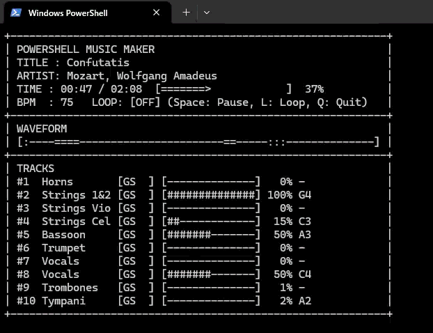

<p align="center">
  
</p>

<h1 align="center">PowerShell Music Maker</h1>

<p align="center">
  <b>ピアノロールGUIで作曲し、単体で鳴る PowerShell スクリプト (.ps1) を出力するデスクトップDAW。</b><br>
  外部シンセや追加ソフトは不要！ Windows標準の <code>[Console]::Beep</code> と Microsoft GS Wavetable Synth だけで音楽を演奏します。
</p>

<p align="center">
  <a href="./README.md"><b>English README is available here</b></a>
</p>

<p align="center">
  
  
  
  
  
</p>

---

## 📸 デモ & スクリーンショット

### 🖥️ デスクトップDAW GUI


### 📟 CLIビジュアライザ実機実行 (.ps1)
<p align="center">
  
</p>

---

## ✨ 主な特徴

- **🎛️ トラック単位のハイブリッド音源 (Beep × GS Synth)**
  - トラックごとに出力先音源を **Beep** (`[Console]::Beep`) または **GS** (Microsoft GS Wavetable Synth) から自由に指定可能。
  - レトロな単音Beepのピコピコ感と、128音色のGM音色・和音・ドラムを1曲の中で同時に組み合わせて演奏できます。
- **⏱️ 絶対時刻同期・累積誤差ゼロの正確なタイムライン**
  - 時間管理は高解像度 480 PPQ (Pulse Per Quarter Note) で保持。
  - 差分の丸めによる演奏のズレ（ジッター）を防ぐため、累積tickから絶対ミリ秒を計算し、`[Diagnostics.Stopwatch]` で精密に同期します。
- **💻 依存関係ゼロのピュアな PowerShell (.ps1) スクリプト生成**
  - **Windows PowerShell 5.1** および **PowerShell 7 (pwsh)** の双方でそのまま動作する `Add-Type` 雛形を採用。
  - スクリプト実行時にコンソール画面へ再生アニメーションと音名を表示する「CLIビジュアライザ」機能も搭載。
  - クリップボードへのワンクリックコピー、および UTF-8 BOM付き `.ps1` 保存に対応。
- **🎧 アプリ内試聴 & 実機テスト機能**
  - Tauri (Rust) バックエンドにより、出力スクリプトと**完全に同一のタイムラインロジック**でリアルタイム試聴が可能。
  - お使いのWindows環境で Beep や GS Wavetable Synth が正常に鳴るか確認できる「環境テスト」画面を完備。
- **🎹 ネオブルータリズム調の直感的なピアノロール**
  - 太い黒枠・ハードシャドウ・原色アクセント（Beep=黄、GS=水色）による視認性の高いUIデザイン。
  - ペンツール、矩形選択、ドラッグ移動、Alt+ドラッグ複製、Shift+矢印による音符長伸縮、コピペ（Ctrl+C/V/D）、グリッド吸着など充実した編集機能を搭載。
- **💾 プロジェクト保存・MIDIインポート**
  - 独自形式 `.psmm` でプロジェクトの保存・復元が可能。
  - 標準MIDIファイル (`.mid` / `.midi`) のインポートに対応し、トラックごとに自動展開。
- **🌐 完全多言語対応**
  - 日本語 / 英語をいつでも設定画面から切り替え可能。

---

## 🚀 クイックスタート

### 1. ダウンロード
[GitHub Releases](https://github.com/yuta0801/powershell-music-maker/releases) から最新バージョンのインストーラー (`.msi` または `.exe`) をダウンロードしてインストールします。

### 2. 基本的な作曲手順
1. **トラックの作成**: 左側サイドバーからトラックを追加し、音源を選択します。
   - **Beep**: 単音のPCスピーカー音。
   - **GS**: 和音や128種類の音色、チャンネル10のドラムが使用可能。
2. **ノートの入力**: ピアノロール上でクリックしてノートを配置します。端をドラッグして長さを調整できます。
3. **アプリ内で試聴**: ヘッダーの「**再生**」ボタンを押してその場でプレビューします。
4. **スクリプト出力**: 「**スクリプト生成**」ボタンを押し、コードをコピーするか `.ps1` として保存します。

### 3. 生成されたスクリプトの実行
PowerShell コンソールを開いてスクリプトを実行するだけです。

```powershell
powershell -ExecutionPolicy Bypass -File .\music.ps1
```

PowerShell 7 の場合:

```powershell
pwsh -File .\music.ps1
```

> **ヒント**: スクリプトの内容をコピーして PowerShell コンソールにそのまま貼り付けて実行することも可能です。

---

## ⌨️ 主なショートカット・操作一覧

| 操作 / ショートカット | 説明 |
| :--- | :--- |
| **グリッドをクリック** | ノートの配置 / 削除（ペンツール時） |
| **ノートをドラッグ** | 音高・タイミングの移動 |
| **Alt + ドラッグ** | ノートを複製して移動 |
| **Shift + ドラッグ** | 範囲選択（ラバーバンド） |
| **Shift + ← / →** | 選択中のノートの長さをグリッド単位で伸縮 |
| **矢印キー** | 選択中のノートを微調整（音高・時間） |
| **ノートを右クリック** | ノートを削除 |
| **Ctrl + C / Ctrl + V** | ノートのコピー / 貼り付け |
| **Ctrl + D** | 選択中のノートを直後に複製 |
| **Ctrl + A** | アクティブトラックのノートを全選択 |
| **Delete / Backspace** | 選択中のノートを削除 |
| **Ctrl + マウスホイール** | ピアノロールの横方向ズーム |
| **Ctrl + S / Ctrl + Shift + S** | プロジェクト上書き保存 / 名前を付けて保存 (`.psmm`) |
| **Ctrl + O / Ctrl + N** | プロジェクトを開く / 新規作成 |

---

## 🤖 CLI & MCP (Model Context Protocol) サーバー

GUIに加えて、ターミナルからパイプライン操作できる **CLI** および AI エージェント（Claude Desktop、Cursor、Cline等）と対話連携できる **MCP サーバー**（`psmusic.exe`）が利用可能です。

### 1. バイナリのビルドと実行

```bash
# release ビルド（target/release/psmusic.exe が生成されます）
cargo build --release -p psmusic-cli

# または npm スクリプト経由で直接実行
npm run cli -- --help
npm run mcp
```

---

### 2. CLI コマンド仕様

#### 🎼 スクリプト生成 (`generate`)
プロジェクトJSONからスタンドアロンの PowerShell スクリプト (`.ps1`) をコンパイルします。

```bash
# ファイルから生成
psmusic generate song.json -o music.ps1

# 標準入力・パイプライン連携
cat song.json | psmusic generate > music.ps1

# ビジュアライザを無効化（軽量・静音実行向け）
psmusic generate song.json -o music.ps1 --no-visualizer

# Beep音の重複解決ルール（latest: 後優先で切詰 / ignore: 発音中の音を維持）
psmusic generate song.json --beep-overlap ignore
```

| オプション | 引数 | 説明 |
| :--- | :--- | :--- |
| `input` | ファイルパス / `-` | 入力JSONパス（デフォルト: `-` 標準入力） |
| `-o, --output` | ファイルパス | 出力先 `.ps1`（省略時は標準出力） |
| `--no-visualizer` | フラグ | ANSI/ASCII コンソールビジュアライザを省略 |
| `--beep-overlap` | `latest` / `ignore` | Beep同時発音時の処理（デフォルト: `latest`） |

#### 🎧 ターミナル即時試聴 (`play`)
ローカルPCのスピーカー（WinMM & kernel32 Beep）で曲を直接演奏・プレビューします。プロジェクトJSONだけでなく標準MIDIファイル (`.mid`) の直接再生にも対応しています。

```bash
psmusic play song.json
psmusic play classical.mid
cat song.json | psmusic play -
```

#### 🛠️ ハードウェア診断テスト (`test`)
お使いの環境で PowerShell の Beep 音および Microsoft GS Wavetable Synth が正常に動作するかテストします。

```bash
# PS 5.1, PowerShell 7, GS Synth すべてをテスト
psmusic test

# 特定のシェルのみテスト
psmusic test pwsh
psmusic test powershell
```

#### 🔄 MIDI インポート / エクスポート (`midi-import`, `midi-export`)
標準MIDIファイル (`.mid`) と本アプリのプロジェクトJSONを双方向変換します。

```bash
# MIDI をプロジェクト JSON に変換
psmusic midi-import bgm.mid -o song.json

# プロジェクト JSON を MIDI ファイルに変換
psmusic midi-export song.json -o bgm.mid
```

#### 📄 プロジェクト初期化 (`init`)
新規プロジェクト用のテンプレートJSONを生成します。

```bash
psmusic init -o new_song.json --bpm 128 --bars 8
```

---

### 3. MCP サーバーとしての連携 (AIエージェントによる自動作曲)

`psmusic mcp` を起動すると、**stdio (標準入出力 JSON-RPC 2.0)** で動作する MCP サーバーとして機能します。AIエージェントが楽曲プロジェクトを自律的に作成・編集・出力・試聴できます。

#### ⚙️ クライアント設定例

**Claude Desktop (`%APPDATA%\Claude\claude_desktop_config.json`)**:
```json
{
  "mcpServers": {
    "powershell-music-maker": {
      "command": "C:\\path\\to\\powershell-music-maker\\target\\release\\psmusic.exe",
      "args": ["mcp"]
    }
  }
}
```

**Cursor / Cline / Windsurf**:
プロジェクト直下の `.cursor/mcp.json` 等に設定:
```json
{
  "mcpServers": {
    "psmusic": {
      "command": "cargo",
      "args": ["run", "-p", "psmusic-cli", "--", "mcp"]
    }
  }
}
```

#### 🧰 提供される MCP ツール一覧

| ツール名 | パラメータ | 説明 |
| :--- | :--- | :--- |
| `psmusic_create_project` | `file_path?`, `bpm?`, `bars?` | 新規楽曲JSONを作成（省略時は `./psmusic-project.json`） |
| `psmusic_add_track` | `file_path?`, `name`, `output` ("beep"/"gs"), `channel?`, `program?`, `volume?` | トラックを追加（Ch9=ドラム、Program 0-127=GM音色） |
| `psmusic_add_notes` | `file_path?`, `track_index`, `notes` (配列: `start_tick`, `duration_tick`, `pitch`, `velocity?`) | 指定トラックに音符を追加（PPQ=480, 1拍=480tick, 1小節=1920tick） |
| `psmusic_get_project` | `file_path?` | 楽曲全体のサマリー・トラック一覧・ノート数を取得 |
| `psmusic_generate_script` | `file_path?`, `output_path?`, `visualizer?` | 実行可能な PowerShell スクリプト (`.ps1`) を書き出し |
| `psmusic_import_midi` | `midi_path`, `output_path?` | MIDIファイルを取り込みプロジェクトJSONに変換 |
| `psmusic_export_midi` | `file_path?`, `output_path` | プロジェクトを標準MIDIファイルとしてエクスポート |
| `psmusic_play` | `file_path?`, `blocking?` | ローカルスピーカーで試聴演奏を開始 |
| `psmusic_stop` | なし | 試聴演奏を即時停止 |
| `psmusic_test_environment`| なし | Beep（powershell/pwsh）およびGS音源の健全性を診断 |

> **状態管理のハイブリッド仕様**: `file_path` を省略した場合、直前に操作したプロジェクトファイル（またはカレントディレクトリの `psmusic-project.json`）が自動的に対象となります。

#### 💡 AIエージェントへの指示例
- *「8bitレトロゲーム風の曲を作って。Beepトラックで軽快なベースラインを鳴らし、GSのチップ矩形波（Program 80）でメロディを重ねて、スクリプトを出力して」*
- *「BPM 140、4小節のシンプルなドラム（GS Ch 9）とピアノコード進行を作って、そのまま `psmusic_play` で試聴させて」*

---

## 🛠️ 開発・ビルド方法

### 前提環境
- [Node.js](https://nodejs.org/) (v18以上)
- [Rust](https://rustup.rs/) (stable ツールチェーン)
- [Visual Studio C++ Build Tools](https://visualstudio.microsoft.com/visual-cpp-build-tools/)

### リポジトリの準備と開発実行
```bash
# リポジトリをクローン
git clone https://github.com/yuta0801/powershell-music-maker.git
cd powershell-music-maker

# 依存パッケージのインストール
npm install

# 開発モードでアプリを起動
npm run tauri dev
```

### インストーラー / バイナリのビルド
```bash
# 本番向けビルド (MSI / EXE 等)
npm run tauri build
```
ビルド結果は `src-tauri/target/release/bundle/` 配下に出力されます。

---

## 🧱 技術スタック & アーキテクチャ

- **UIフレームワーク**: [Svelte 5](https://svelte.dev/) (Runesリアクティビティ) + [SvelteKit](https://kit.svelte.dev/) + TypeScript
- **デザインシステム**: 純粋なCSSによるネオブルータリズム設計（UIライブラリ不使用）
- **アイコン**: [@lucide/svelte](https://lucide.dev/)
- **デスクトップ基盤**: [Tauri v2](https://v2.tauri.app/)
- **ネイティブ音声バックエンド**: Rust (`windows` クレートによる `winmm` GS Synth直接呼び出し、`kernel32::Beep` によるBeep試聴)
- **MIDI解析**: [@tonejs/midi](https://github.com/Tonejs/Midi)

---

## 📄 ライセンス

このプロジェクトは [MIT License](LICENSE) のもとで公開されています。
