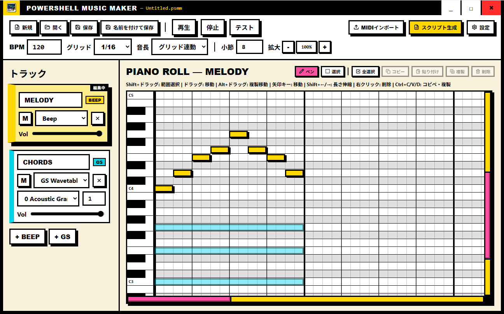

<p align="center">
  
</p>

<h1 align="center">PowerShell Music Maker</h1>

<p align="center">
  <b>A Neo-Brutalist Piano Roll DAW that exports standalone PowerShell (.ps1) music scripts.</b><br>
  No external synthesizers or dependencies required — play music directly in Windows Console using <code>[Console]::Beep</code> and Microsoft GS Wavetable Synth!
</p>

<p align="center">
  <a href="./README.ja.md"><b>🇯🇵 日本語ドキュメントはこちら (Japanese README)</b></a>
</p>

<p align="center">
  
  
  
  
  
</p>

---

## 📸 Screenshot



---

## ✨ Features

- **🎛️ Track-based Hybrid Sound Sources (Beep + GS Synth)**
  - Assign either **Beep** (`[Console]::Beep`) or **GS** (Microsoft GS Wavetable Synth via winmm P/Invoke) per track.
  - Mix retro single-voice PC beeps and rich 128-instrument General MIDI chords/drums simultaneously in one song.
- **⏱️ Absolute Timeline & Zero Drift**
  - High-precision timekeeping based on 480 PPQ (Pulse Per Quarter Note).
  - Absolute millisecond timestamps prevent rounding error accumulation, synchronized via `[Diagnostics.Stopwatch]`.
- **💻 Standalone PowerShell (.ps1) Script Generation**
  - Generates self-contained `.ps1` scripts compatible with both **Windows PowerShell 5.1** and **PowerShell 7+ (pwsh)**.
  - Interactive ASCII visualizer option displaying real-time playback notes right in your console.
  - One-click copy to clipboard or save as UTF-8 BOM `.ps1` file.
- **🎧 In-App Preview & Environment Testing**
  - Seamless in-app playback engine powered by Tauri & Rust sharing the exact same timeline logic as the exported script.
  - Built-in hardware test suite: test Windows Beep across PowerShell 5.1 and pwsh, and verify GS Wavetable Synth device availability with one click.
- **🎹 Neo-Brutalist Piano Roll Editor**
  - High-contrast, bold borders, hard-drop shadows, and vibrant color-coding (Yellow for Beep, Cyan for GS Synth).
  - Intuitive editing tools: Pencil, Rubber-band Selection, Note Resize (Shift+Arrow), Drag-to-Duplicate (Alt+Drag), Copy/Paste/Duplicate (Ctrl+C/V/D), Grid Snapping, and Length Presets.
- **💾 Project Files & MIDI Import**
  - Save and load work in native `.psmm` JSON format.
  - Import Standard MIDI files (`.mid` / `.midi`) with track auto-mapping.
- **🌐 Bilingual UI**
  - Full Japanese and English UI support, switchable at any time in Settings.

---

## 🚀 Getting Started

### 1. Download
Grab the latest release installer (`.msi` or `.exe`) from the [GitHub Releases](https://github.com/yuta0801/powershell-music-maker/releases) page.

### 2. Basic Workflow
1. **Add Tracks**: Create tracks and pick their sound engine:
   - **Beep**: Monophonic retro beep sound.
   - **GS**: Polyphonic MIDI synthesizer (choose from 128 General MIDI instruments or Channel 10 Drum Kit).
2. **Compose**: Click on the piano roll grid to place notes, drag to reposition, or drag note edges to resize.
3. **Preview**: Hit **Play** to listen to your creation right inside the app.
4. **Export Script**: Click **Export Script** to view generated PowerShell code, copy to clipboard, or save to a `.ps1` file.

### 3. Running the Exported Script
Open PowerShell and run the script:

```powershell
powershell -ExecutionPolicy Bypass -File .\music.ps1
```

Or in PowerShell 7:

```powershell
pwsh -File .\music.ps1
```

> **Note**: You can also paste the script directly into an active PowerShell prompt.

---

## ⌨️ Shortcuts & Controls

| Shortcut / Action | Description |
| :--- | :--- |
| **Click on Grid** | Create / delete note with selected pencil tool |
| **Drag Note** | Move notes in pitch / time |
| **Alt + Drag** | Duplicate and move notes |
| **Shift + Drag** | Rubber-band selection |
| **Shift + ← / →** | Extend / shrink selected note duration |
| **Arrow Keys** | Nudge selected notes (Pitch / Time) |
| **Right Click** | Delete note |
| **Ctrl + C / Ctrl + V** | Copy / Paste notes |
| **Ctrl + D** | Duplicate selected notes |
| **Ctrl + A** | Select all notes on current track |
| **Delete / Backspace** | Delete selected notes |
| **Ctrl + Mouse Wheel** | Horizontal Zoom In / Out |
| **Ctrl + S / Ctrl + Shift + S** | Save / Save As project (`.psmm`) |
| **Ctrl + O / Ctrl + N** | Open project / New project |

---

## 🤖 CLI & MCP (Model Context Protocol) Server

In addition to the GUI desktop app, a standalone CLI tool and an MCP server (`psmusic.exe`) are available for headless pipeline workflows and AI agent integrations (Claude Desktop, Cursor, Cline, etc.).

### 1. Building and Running

```bash
# Build release binary (generates target/release/psmusic.exe)
cargo build --release -p psmusic-cli

# Or run directly via npm scripts
npm run cli -- --help
npm run mcp
```

---

### 2. CLI Command Reference

#### 🎼 Script Generation (`generate`)
Compile a project JSON into a standalone PowerShell script (`.ps1`).

```bash
# Compile from file
psmusic generate song.json -o music.ps1

# Pipeline streaming with stdin and stdout
cat song.json | psmusic generate > music.ps1

# Disable console visualizer (for silent/lean execution)
psmusic generate song.json -o music.ps1 --no-visualizer

# Beep overlap resolution ('latest' = cut off previous note, 'ignore' = keep playing note)
psmusic generate song.json --beep-overlap ignore
```

| Flag | Argument | Description |
| :--- | :--- | :--- |
| `input` | File path / `-` | Input JSON path (default: `-` stdin) |
| `-o, --output` | File path | Destination `.ps1` path (default: stdout) |
| `--no-visualizer` | Flag | Omit ASCII / ANSI live console visualizer |
| `--beep-overlap` | `latest` / `ignore` | Monophonic Beep conflict resolution (default: `latest`) |

#### 🎧 Instant Terminal Playback (`play`)
Preview musical projects directly through local Windows speakers using WinMM and kernel32 Beep. Supports both project JSON files and standard MIDI files (`.mid`).

```bash
psmusic play song.json
psmusic play classical.mid
cat song.json | psmusic play -
```

#### 🛠️ Audio Diagnostics (`test`)
Test whether your Windows machine can play Beep sounds and send MIDI messages to Microsoft GS Wavetable Synth.

```bash
# Test PowerShell 5.1, PowerShell 7, and GS Synth
psmusic test

# Test specific shell
psmusic test pwsh
psmusic test powershell
```

#### 🔄 MIDI Import / Export (`midi-import`, `midi-export`)
Convert back and forth between Standard MIDI Files (`.mid`) and PowerShell Music Maker project JSON.

```bash
# Import MIDI to project JSON
psmusic midi-import bgm.mid -o song.json

# Export project JSON to MIDI
psmusic midi-export song.json -o bgm.mid
```

#### 📄 Project Initialization (`init`)
Create an empty project template.

```bash
psmusic init -o new_song.json --bpm 128 --bars 8
```

---

### 3. MCP Server Integration (Autonomous AI Composition)

Running `psmusic mcp` starts a **stdio (JSON-RPC 2.0)** Model Context Protocol server. AI coding assistants can autonomously compose songs, place notes, compile scripts, and preview playback.

#### ⚙️ Client Configuration Examples

**Claude Desktop (`%APPDATA%\Claude\claude_desktop_config.json`)**:
```json
{
  "mcpServers": {
    "powershell-music-maker": {
      "command": "C:\\path\\to\\powershell-music-maker\\target\\release\\psmusic.exe",
      "args": ["mcp"]
    }
  }
}
```

**Cursor / Cline / Windsurf**:
In your project `.cursor/mcp.json` or Cline configuration:
```json
{
  "mcpServers": {
    "psmusic": {
      "command": "cargo",
      "args": ["run", "-p", "psmusic-cli", "--", "mcp"]
    }
  }
}
```

#### 🧰 Available MCP Tools

| Tool Name | Parameters | Description |
| :--- | :--- | :--- |
| `psmusic_create_project` | `file_path?`, `bpm?`, `bars?` | Create new musical project JSON (defaults to `./psmusic-project.json`) |
| `psmusic_add_track` | `file_path?`, `name`, `output` ("beep"/"gs"), `channel?`, `program?`, `volume?` | Add a track (Ch 9=Drums, Program 0-127=GM voices) |
| `psmusic_add_notes` | `file_path?`, `track_index`, `notes` (array of `start_tick`, `duration_tick`, `pitch`, `velocity?`) | Add notes in ticks (PPQ=480: 1 beat=480 ticks, 1 bar=1920 ticks) |
| `psmusic_get_project` | `file_path?` | Retrieve project overview, tracks, duration, and note count |
| `psmusic_generate_script` | `file_path?`, `output_path?`, `visualizer?` | Compile into runnable `.ps1` script |
| `psmusic_import_midi` | `midi_path`, `output_path?` | Import MIDI file and convert to project JSON |
| `psmusic_export_midi` | `file_path?`, `output_path` | Export project to a Standard MIDI file |
| `psmusic_play` | `file_path?`, `blocking?` | Play music through local speakers |
| `psmusic_stop` | None | Stop active playback |
| `psmusic_test_environment`| None | Diagnose Beep and GS Synth audio hardware |

> **Hybrid Session Management**: When `file_path` is omitted, the tool automatically operates on the most recently modified project (or `./psmusic-project.json`).

#### 💡 Example Prompts for AI Agents
- *"Create an 8-bit retro track: place an upbeat bassline using a Beep track, add a lead melody with GS Lead 1 (Square, Program 80), and export a standalone `.ps1`."*
- *"Compose a 4-bar piano chord progression with drum beats at 120 BPM, then call `psmusic_play` to preview it for me."*

---

## 🛠️ Development

### Prerequisites
- [Node.js](https://nodejs.org/) (v18+)
- [Rust](https://rustup.rs/) (stable toolchain)
- [Visual Studio C++ Build Tools](https://visualstudio.microsoft.com/visual-cpp-build-tools/)

### Setup & Run
```bash
# Clone the repository
git clone https://github.com/yuta0801/powershell-music-maker.git
cd powershell-music-maker

# Install frontend dependencies
npm install

# Run desktop app in development mode
npm run tauri dev
```

### Production Build
```bash
# Build desktop executable and installer
npm run tauri build
```
Built binaries will be located in `src-tauri/target/release/bundle/`.

---

## 🧱 Architecture & Tech Stack

- **UI Framework**: [Svelte 5](https://svelte.dev/) (Runes reactivity system) + [SvelteKit](https://kit.svelte.dev/) + TypeScript
- **Styling**: Pure CSS Neo-Brutalist Design System (zero CSS framework overhead)
- **Icons**: [@lucide/svelte](https://lucide.dev/)
- **Desktop Runtime**: [Tauri v2](https://v2.tauri.app/)
- **Native Audio Backend**: Rust (`winmm` via `windows` crate for GS Synth, `kernel32::Beep` for Beep preview)
- **MIDI Parsing**: [@tonejs/midi](https://github.com/Tonejs/Midi)

---

## 📄 License

This project is licensed under the [MIT License](LICENSE).
